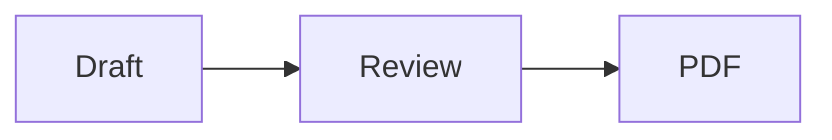

<h1 align="center">mdtopdf: Agent-friendly Markdown-to-PDF CLI</h1>

<p align="center">
  <a href="https://github.com/ABClize/mdtopdf/blob/main/README_CN.md">中文文档</a> |
  <a href="https://github.com/ABClize/mdtopdf/blob/main/README.es-ES.md">Español</a>
</p>

<p align="center">
  <a href="#quick-start"></a>
  <a href="#agent-workflow"></a>
  <a href="#visual-output"></a>
  <a href="https://pypi.org/project/agent-markdown-pdf/"></a>
  <a href="https://github.com/ABClize/mdtopdf/blob/main/LICENSE"></a>
</p>

<p align="center">
  
  
  
  
</p>

**One command** gives agents a controlled Markdown-to-PDF path.

<p align="center">
  
</p>

---

## Why it works for agents

Agents are good at writing Markdown. The problem is the handoff: PDFs exported
through ad hoc paths rarely share the same style. `mdtopdf` gives the user a
command-line interface where the style can be defined up front.

- **Agent-friendly** - `mdtopdf --help` is an interface description an agent can read.
- **JSON when it matters** - conversion, HTML preview, environment checks, and theme listing can return machine-readable output.
- **Local files in, local files out** - an isolated headless browser, no upload step, no remote rendering service.
- **More than plain Markdown** - Obsidian links, highlights, frontmatter, comments, and callouts are rendered.

## Quick start

Install from PyPI in your Python environment:

```shell
python -m pip install "agent-markdown-pdf>=0.4.0"
```

The PyPI distribution is `agent-markdown-pdf`; it installs the `mdtopdf` command.
Do not use `mdtopdf` as the PyPI package name; the distribution name is
intentionally different from the command name.

| Use case | Name |
| --- | --- |
| Install from PyPI | `agent-markdown-pdf` |
| Run the CLI | `mdtopdf` |
| Import in Python | `mdtopdf` |

Check the machine before the first conversion:

```shell
mdtopdf doctor --render-check --json
```

The package installs the Python dependencies, including Playwright. You also need
a compatible Chromium browser and the fonts your documents use. An installed
Chrome, Edge, or Chromium is discovered automatically; if none is found, follow
[Browser setup](#browser-setup). This check actually renders PDF, math, and diagrams.

Convert a file:

```shell
mdtopdf convert report.md -o report.pdf --overwrite
```

Try the bundled visual test document:

```shell
git clone https://github.com/ABClize/mdtopdf.git
cd mdtopdf
python -m pip install -e ".[dev]"
python -m playwright install chromium --no-shell
mdtopdf html examples/visual-test-en.md -o visual-test-en.html --overwrite
mdtopdf convert examples/visual-test-en.md -o visual-test-en.pdf --overwrite --json
```

The same visual test is also available in Chinese at
`examples/visual-test-cn.md`.

## Updating

There is no `mdtopdf update` command. For a pip-installed release, activate the
same virtual environment (or select the same Python interpreter) used to install it:

```shell
python -m pip install --upgrade agent-markdown-pdf
python -m mdtopdf --version
```

This updates from the package index, not from the development branch.
For pipx or uv tool installations, use that tool's upgrade workflow instead.
For editable/source installs, update the intended checkout and reinstall from it;
do not replace a development install with a PyPI release by accident.

Pin a tested version in your deployment requirements rather than upgrading on
every job. After upgrading to 0.3.0 or later, run `mdtopdf doctor --render-check --json`
and review a representative PDF. If Playwright now needs a different managed
browser, follow [Browser setup](#browser-setup). Conversion does not check for
updates or upgrade the package/browser automatically.

## Agent workflow

The bundled agent skill lives at
[`mdtopdf/skills/SKILL.md`](https://github.com/ABClize/mdtopdf/blob/main/mdtopdf/skills/SKILL.md).
Use that file when another agent needs a compact runtime guide for `mdtopdf`.

```shell
mdtopdf doctor --json
mdtopdf convert report.md -o report.pdf --overwrite --json
```

Agents can also send UTF-8 Markdown directly to `convert -`, without saving an
input file. An explicit output file is required; PDF bytes are not written to stdout.

```shell
printf '# Report\n\nGenerated by an agent.\n' | mdtopdf convert - -o report.pdf --json
```

PowerShell (set the pipe encoding for non-ASCII text, especially in Windows PowerShell 5.1):

```powershell
$OutputEncoding = [System.Text.UTF8Encoding]::new($false)
'# Report' | mdtopdf convert - -o report.pdf --json
```

Relative resources resolve from the working directory unless `--base-url` is set.
Use `--resource-dir` for bare attachment names and `--title` for the document title
and default header (otherwise `stdin`). JSON reports `input: "-"` and `source: "stdin"`.
Empty or non-UTF-8 input fails; `--overwrite` and `--strict` behave as with files.
The `html` command still takes a file path.

Use HTML preview when layout needs a quick look:

```shell
mdtopdf html report.md -o report.html --overwrite --json
mdtopdf convert report.md -o report.pdf --overwrite --json
```

`convert --json` returns the input path, output path, file size, theme, font
check summary, warnings, and render method. If conversion fails in JSON mode,
the error is structured enough for an agent to show the command, explain the
likely cause, and retry after a fix.

A successful conversion can still have warnings: a missing image, an unavailable
font, or an unsupported formula shown as source. Read `warnings` before handing over the PDF.
For jobs that must not accept these fallbacks:

```shell
mdtopdf convert report.md -o report.pdf --overwrite --strict --json
mdtopdf doctor --render-check --json
```

`--strict` leaves an existing output untouched when a diagnostic is raised.
It is also available for file-based HTML previews. Math and Mermaid are rendered
to static HTML/SVG in Chromium; plain HTML export does not start a browser and
does not check image loading. `doctor --render-check` tests PDF, KaTeX, and Mermaid
together. It checks runtime health, not visual parity across machines.
Exit codes are `0` for success, `1` for runtime or strict-check failures, and
`2` for invalid arguments. Missing fonts are advisory; a missing browser or
bundled renderer makes the basic doctor check fail.

## Visual output

The gallery below is rendered from the final PDF produced by
`examples/visual-test-en.md`. It shows the actual pages an agent can hand back
to a user: headings, callouts, tables, code, math, images, Mermaid, and
pagination. The images show the 0.4.0 renderer, with Pele diagrams
and Chromium PDF rendering.

| Page 1 | Page 2 |
| --- | --- |
|  |  |
| Page 3 | Page 4 |
|  |  |
| Page 5 | Page 6 |
|  |  |

## How it works

```text
Markdown -> markdown-it-py HTML -> theme/custom CSS -> Chromium PDF
```

One Chromium session renders formulas with bundled KaTeX and Mermaid code blocks
with bundled Pele, waits for fonts and images, and prints the PDF. No separate
Mermaid CLI, Node.js installation, WeasyPrint, or MSYS2 setup is needed. Browser
installation is an explicit setup step; conversion never downloads a browser.

### Mermaid diagrams with Pele

Keep using `mermaid` or `mmd` fenced code blocks:

````markdown

````

Pele produces SVG for HTML preview and PDF. Diagram label formulas written as
`$$...$$` use the bundled KaTeX renderer. The default SVG theme matches the
document's soft lavender palette and Latin-first font stack, with pale purple
nodes, dark text, and gray-purple connectors.

To customize the document and diagram palette, pass a CSS file with `--css`:

```css
:root {
  --mdtopdf-accent: #7352a6;
  --mdtopdf-surface: #f3effa;
}
.mermaid-diagram {
  --pele-border: #b5a2cf;
}
```

Shared palette variables are `--mdtopdf-background`, `--mdtopdf-text`,
`--mdtopdf-heading`, `--mdtopdf-accent`, `--mdtopdf-muted`, `--mdtopdf-surface`,
`--mdtopdf-surface-alt`, `--mdtopdf-border`, and `--mdtopdf-critical`.
Heading levels 2–6 also have `--mdtopdf-heading-2` through `--mdtopdf-heading-6`.
Local `--pele-*` overrides still customize diagrams independently.

Diagram layout uses the configured `@page` size and margins, including named
pages. Before pagination, it conservatively uses the smallest available width
and height across matching first/left/right page styles. The source diagram
direction is preserved. This supports common print CSS; inspect the final PDF
when using more complex page rules.

If fitting a diagram makes its text smaller than approximately **8pt**, the
result includes a `diagram_text_too_small` warning with the diagram index and
estimated printed font size. Prefer a wider page, larger labels, or smaller
diagrams. To adjust the warning threshold, use
`.mermaid-diagram { --mdtopdf-diagram-min-font-size: 9pt; }` in your CSS.
This changes the check, not the font size. `--strict` rejects the warning and
preserves an existing output.

Diagram failures return `error_code: "diagram_render_failed"`, an actionable
`hint`, and `error_details` with Pele's code, the 1-based diagram index, and a
source excerpt. When the location can be established, `diagram_line`,
`diagram_column`, and `source_line` refer to the original diagram and Markdown;
`source_start_line` identifies the code block's first content line.
Pele's own `renderer_line` / `renderer_column` are kept separately because its
preprocessing can shift locations. Unknown locations are omitted, not guessed.

Pele has its own layout, so diagram geometry can change. Mermaid `theme` and
`themeVariables` settings do not set its colors; use the CSS variables above.
Arbitrary HTML labels and external Mermaid plugins are unsupported. Review
existing diagrams in HTML and the final PDF. See Pele's
[compatibility guide](https://pele.run/compatibility) and
[theme variables](https://pele.run/theming).

The bundled Pele **1.8.0** requires ASCII Sankey node names. Chinese node names,
including quoted names, fail to parse in this version.

Use `examples/pele-compatibility.md` with its companion CSS to review diagram output:

```shell
mdtopdf html examples/pele-compatibility.md --css examples/pele-compatibility.css -o pele-compatibility.html --overwrite
mdtopdf convert examples/pele-compatibility.md --css examples/pele-compatibility.css -o pele-compatibility.pdf --overwrite
```

### Upgrading from 0.2.x

The command name and Python API stay the same, but the PDF engine changes from
WeasyPrint to Chromium. There is no WeasyPrint fallback. Install/check the browser,
then render a representative document before upgrading an automated workflow.
Page breaks, headers/footers, fonts, and custom paged-media CSS may differ.
JSON consumers should accept the new render-method value rather than hard-code
the old backend. See the [release notes](https://github.com/ABClize/mdtopdf/blob/main/CHANGELOG.md).

## Features

| Feature | Notes |
| --- | --- |
| JSON output | `--json` is available for conversion, HTML preview, doctor, and theme listing. |
| Environment checks | `doctor --json` checks Python imports, the browser executable, bundled KaTeX/Pele assets, and recommended fonts. |
| Local rendering | Markdown, CSS, math, Mermaid SVG generation, and PDF export stay on the machine. |
| HTML preview | Generate standalone HTML before PDF export for fast visual inspection. |
| Obsidian compatibility | Wikilinks, aliases, frontmatter hiding, comments, highlights, and typed callouts. |
| Document Markdown | Tables, task lists, footnotes, heading anchors, fenced code, and Pygments highlighting. |
| KaTeX math | Inline and block TeX render with bundled KaTeX assets, without a CDN. |
| Safe HTML default | Common inline document tags are allowed; unsafe raw HTML stays escaped unless opted in. |
| Python API | Convert Markdown strings or files from your own code. |

## Commands

Render a PDF:

```shell
mdtopdf convert report.md -o report.pdf
mdtopdf convert report.md -o report.pdf --overwrite
```

Preview HTML:

```shell
mdtopdf html report.md -o report.html --overwrite
```

Set document metadata and page chrome:

```shell
mdtopdf convert report.md -o report.pdf --title "Report"
mdtopdf convert report.md -o report.pdf --header "Report" --footer "Draft"
mdtopdf convert report.md -o report.pdf --no-header --no-footer
```

Use extra CSS or resource lookup paths:

```shell
mdtopdf convert report.md -o report.pdf --css print.css
mdtopdf convert report.md -o report.pdf --base-url assets
mdtopdf convert report.md -o report.pdf --resource-dir attachments
```

Custom CSS is the style extension point. Put document-specific rules in a CSS
file; fonts, spacing, colors, page rules, and code block styling all live there.
Use a system-installed font directly, or define `@font-face` for a local font
file. Relative URLs in CSS are resolved from the Markdown file's base URL, so
use `--base-url` when those assets live next to your document:

```css
@font-face {
  font-family: "Report Sans";
  src: url("fonts/NotoSansSC-Regular.otf");
}

:root {
  font-family: "Report Sans", "Noto Sans SC", "Source Han Sans SC", sans-serif;
}

code,
pre {
  font-family: "Cascadia Code", "Liberation Mono", monospace;
}
```

Then pass the CSS file:

```shell
mdtopdf convert report.md -o report.pdf --css print.css --base-url .
```

During export, `mdtopdf` checks the final CSS font stacks. Missing fonts do not
stop PDF generation, but they are reported in CLI warnings and in the JSON
`warnings` field.
Custom CSS also warns when its first named font is missing, even if a fallback
is available. Local `@font-face` files are checked for readability and CJK
coverage; declaring a family is not enough. Remote font sources are not fetched
by this static check and are reported as unverified. These checks do not replace
reviewing the rendered PDF. Pass `--strict` to reject warnings.

Return JSON:

```shell
mdtopdf --json convert report.md -o report.pdf --overwrite
mdtopdf doctor --json
mdtopdf themes list --json
```

Allow raw HTML only for trusted local Markdown:

```shell
mdtopdf convert trusted.md -o trusted.pdf --unsafe-html
```

HTML filtering is not a filesystem or network sandbox. Images and CSS can still
reference local files or remote URLs. Run untrusted documents in an environment
with restricted filesystem access and networking.

## Python API

```python
from mdtopdf import (
    markdown_file_to_html,
    markdown_file_to_pdf,
    markdown_to_html,
    markdown_to_pdf,
)

rendered = markdown_to_html("# Report\n\n==highlight==")
print(rendered.html)

markdown_to_pdf("# Report\n\nBody", "report.pdf", title="Report", overwrite=True)
markdown_file_to_html("report.md", output_path="report.html", overwrite=True)
markdown_file_to_pdf("report.md", output_path="report.pdf", overwrite=True)
```

## Markdown support

`mdtopdf` supports:

- CommonMark
- Tables with content-based column widths and wrapping for long words and URLs
- Strikethrough
- Task lists
- Footnotes
- Heading anchors
- Fenced code blocks with Pygments highlighting
- Obsidian-style `==highlight==` marks
- Obsidian-style `[[target|alias]]` wikilinks
- Obsidian-style `%%comment%%` comments outside code
- Obsidian/YAML frontmatter hiding at the start of the file
- Obsidian-style callouts such as `> [!note] Title`
- Safe inline HTML tags such as `<br>`, `<kbd>`, `<mark>`, `<sup>`, and `<sub>`
- TeX math through `$inline$`, `$$block$$`, and common `amsmath` environments
- Mermaid code blocks through bundled Pele in Chromium

Raw HTML is disabled by default except for the safe subset above. For trusted
local Markdown, pass `--unsafe-html`.

## Browser setup

PDF export requires Chromium. HTML export also uses it when the document has
math or Mermaid. Browser selection is deterministic: `MDTOPDF_BROWSER_EXECUTABLE`,
then legacy `PUPPETEER_EXECUTABLE_PATH`, then installed Playwright Chromium,
then Chrome/Edge/Chromium on PATH or in common Windows/macOS installation folders.
Linux also checks standard installation paths. An invalid explicit path is an error,
not a reason to silently switch browsers. Discovery never downloads or installs anything.

If no browser is available, install the managed browser once:

```shell
python -m playwright install chromium --no-shell
mdtopdf doctor --render-check --json
```

`doctor --json` shows the selected path and its `tools.browser.source`.
Use `--render-check` to verify it actually launches and renders. A browser found
on disk can still lack required system libraries or sandbox support.
An existing recent Chrome or Edge can be selected explicitly:

```powershell
$env:MDTOPDF_BROWSER_EXECUTABLE = "C:\Program Files (x86)\Microsoft\Edge\Application\msedge.exe"
mdtopdf doctor --render-check --json
```

```shell
export MDTOPDF_BROWSER_EXECUTABLE="$(command -v google-chrome)"
mdtopdf doctor --render-check --json
```

The legacy `PUPPETEER_EXECUTABLE_PATH` is accepted if the new variable is unset.
A fresh headless session is used; your personal browser profile is never opened.
Browser errors include an `error_code`, original message, and repair `hint`.

## Platform notes

Use Python 3.10+ and a recent Chromium browser. The Python Playwright package
includes its driver; a separate Node.js or npm installation is not required.
Windows and macOS no longer need an MSYS2 or Homebrew Pango setup.

On a supported Debian/Ubuntu environment, install Chromium's system libraries
during setup, then provide the fonts your documents use:

```shell
python -m playwright install-deps chromium
sudo apt-get update
sudo apt-get install -y --no-install-recommends \
  fontconfig fonts-liberation fonts-dejavu-core fonts-noto-cjk fonts-stix
fc-cache -f
```

Run conversions as a **non-root** user with working browser sandbox support.
If Ubuntu/AppArmor blocks a downloaded browser, use an explicitly configured
system Chrome permitted by the host policy. Do not fix this by disabling the
sandbox. See [Playwright browser setup](https://playwright.dev/python/docs/browsers).

The theme keeps Latin fonts before CJK fonts. Linux uses Liberation Sans /
DejaVu Sans for English and digits, Noto Sans CJK SC for Chinese, and Cascadia
Mono / Cascadia Code for code where installed (otherwise system monospace).
Debian provides Cascadia through `fonts-cascadia-code`. Windows keeps its
existing system font stack. Microsoft YaHei and Segoe UI Emoji are not Linux
requirements and are never downloaded or bundled by mdtopdf.

Emoji still use installed system fonts. The existing Linux preference is
monochrome Noto Emoji, with Noto Color Emoji as a fallback. Browser rendering
removes the old WeasyPrint pipeline, but does not make every font or emoji
sequence identical across operating systems. Review representative PDFs.
KaTeX includes its own math fonts; STIX is an optional math fallback.

Images, CSS, and fonts may use local or remote resources. Document JavaScript
is blocked during conversion, even with `--unsafe-html`; this is not a
filesystem or network sandbox. Use restricted filesystem/network permissions
for untrusted documents. Raw HTML exported with `--unsafe-html` remains trusted
content when opened elsewhere.

## Development

```shell
git clone https://github.com/ABClize/mdtopdf.git
cd mdtopdf
python -m pip install -e ".[dev]"
python -m playwright install chromium --no-shell
python -m pytest tests/ -q
```

Build and check the package:

```shell
python -m build
python -m twine check dist/*
```

## License

MIT. Bundled KaTeX and Pele assets include their MIT licenses at
`mdtopdf/vendor/katex/LICENSE` and `mdtopdf/vendor/pele/LICENSE`.
`mdtopdf/vendor/pele/LICENSE` also includes the Lucide ISC license.
Pele's bundled version, source, and asset hash are recorded in
`mdtopdf/vendor/pele/NOTICE.md`.

`mdtopdf` does not bundle CJK body fonts, emoji fonts, or proprietary system
fonts. The default theme references local system fonts such as Segoe UI,
Microsoft YaHei, PingFang SC, Segoe UI Emoji, Noto Sans CJK SC,
Noto Emoji, Noto Color Emoji, Cascadia Code, and Consolas, but those font files come from
the user's operating system or runtime environment. Public Linux images should
prefer the open-font baseline above.
