## 1. 文档交付流程

Pele 图表兼容与 PDF 视觉检查：中文、ASCII 数字、日期、版本号和工单编号应清晰可见。

| 工单 | 基准日期 | 版本 | 输出 |
| --- | --- | --- | --- |
| IT-001 | 2026-06-22 | v0.2.2 | HTML + PDF |

> [!note] 审阅基准
> 检查节点文字、箭头、图例、公式和分页；图表颜色应与正文蓝灰主题协调。

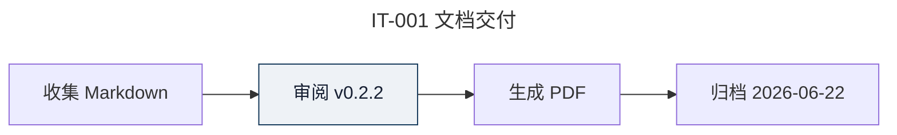

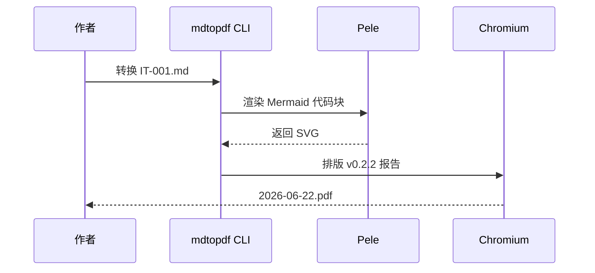

## 2. 报告模型与状态

IT-001 · 2026-06-22 · v0.2.2。检查类成员、关系符号和状态转换标签。

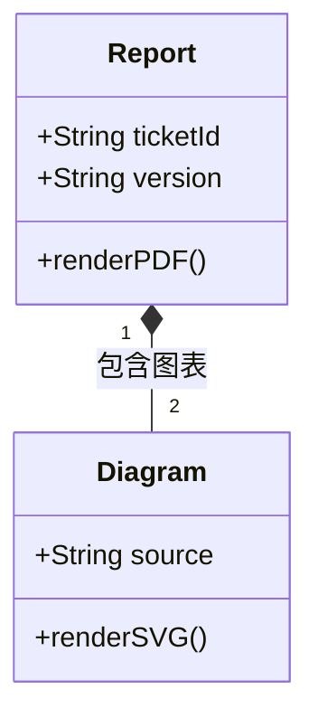


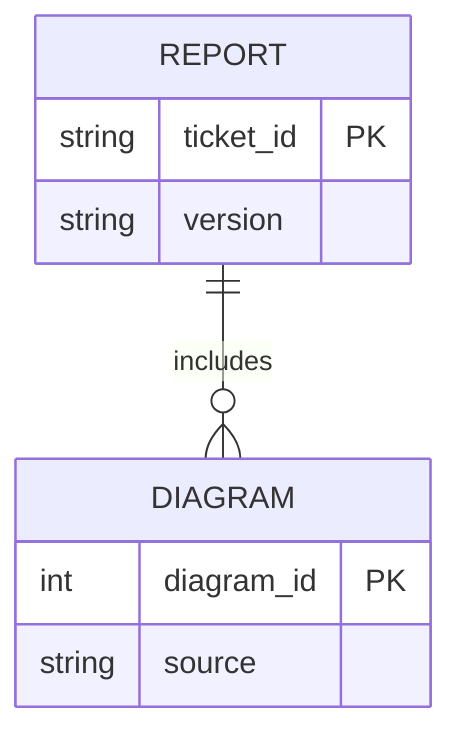

## 3. 交付进度与计划

IT-001 · v0.2.2。图例数量、百分比和日期轴应可读，彩色区域应保留足够对比度。

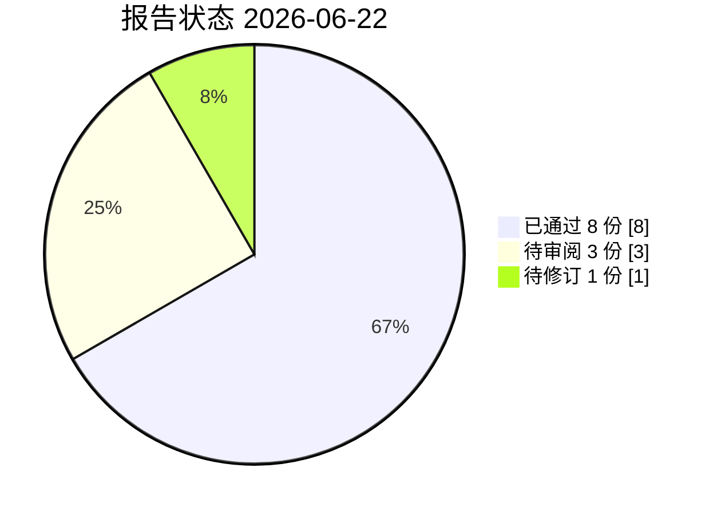

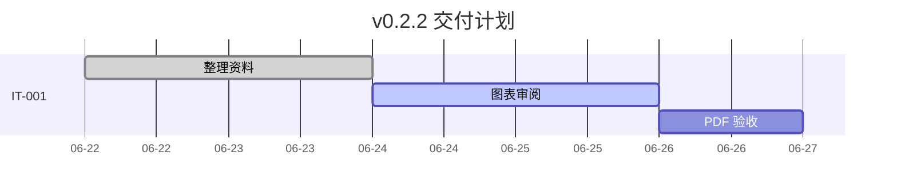

## 4. 检查范围与版本记录

IT-001 · 2026-06-22 · v0.2.2。检查分支层级、中文换行与时间线对齐。

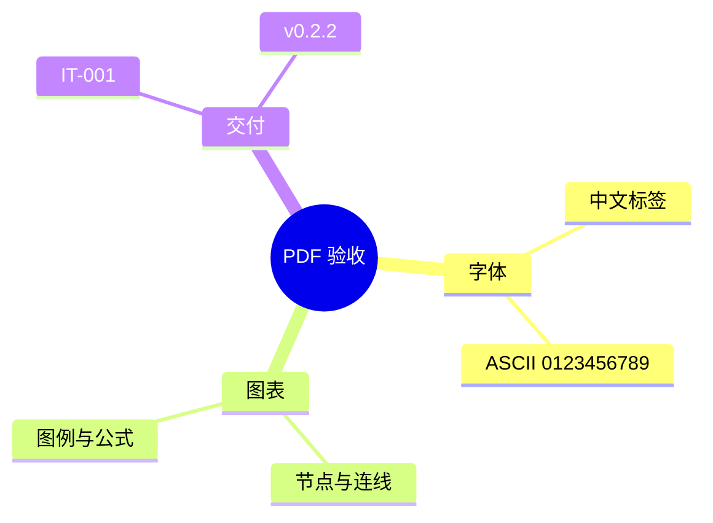

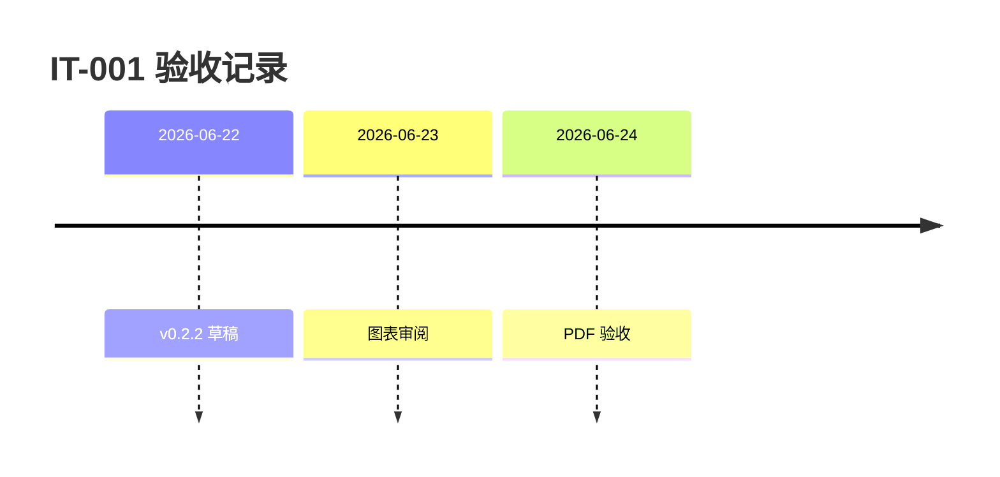

## 5. 数据坐标与趋势

IT-001 · 2026-06-22 · v0.2.2。检查坐标刻度、柱高和趋势线，避免图例或标签被截断。

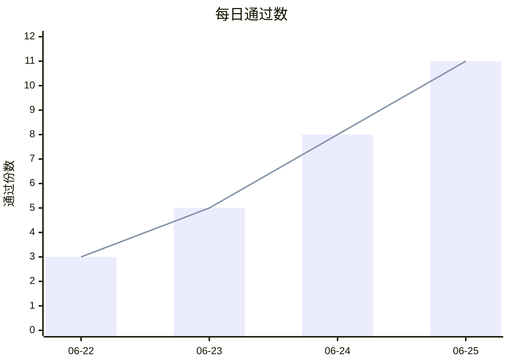

## 6. 桑基图与数据流向

检查流向宽度、数量和标签。内置 Pele 1.8.0 的桑基图节点名须使用 ASCII；其他页展示中文标签。

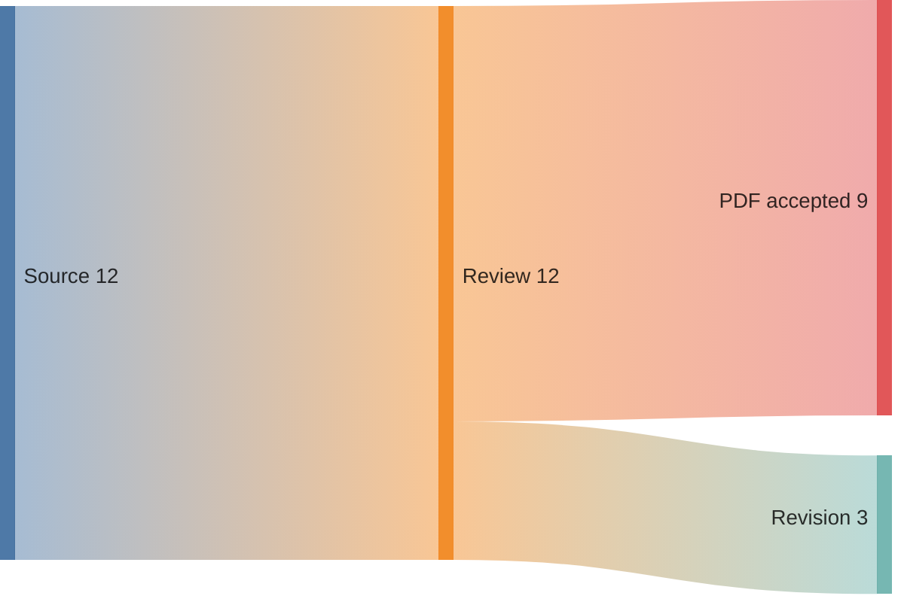

## 7. 版本分支、公式与嵌套代码块

IT-001 · 2026-06-22 · v0.2.2。检查分支标记、数学符号和引用块内的 `mmd` 别名。

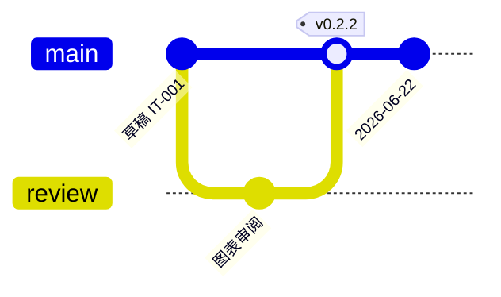

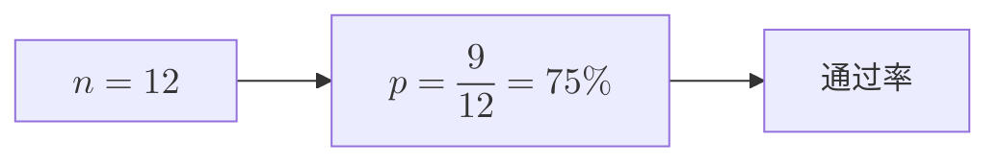

> 引用中的交付检查：保留原有 `mmd` 代码块用法。
>
> ```mmd
> graph LR
>     A[工单 IT-001] --> B[校验 v0.2.2] --> C[交付 PDF]
> ```
